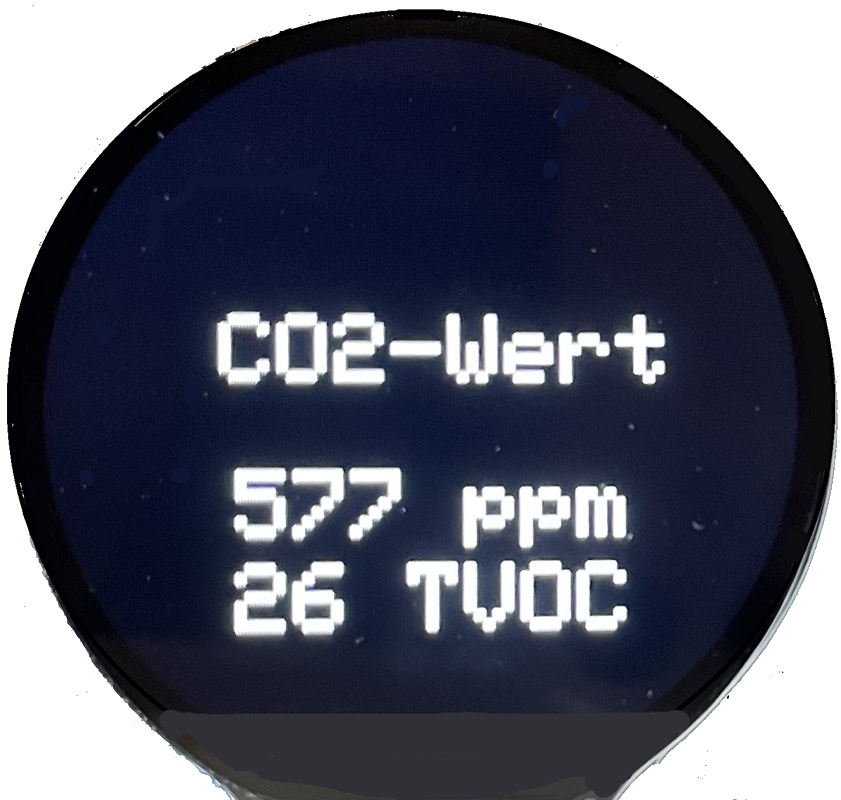
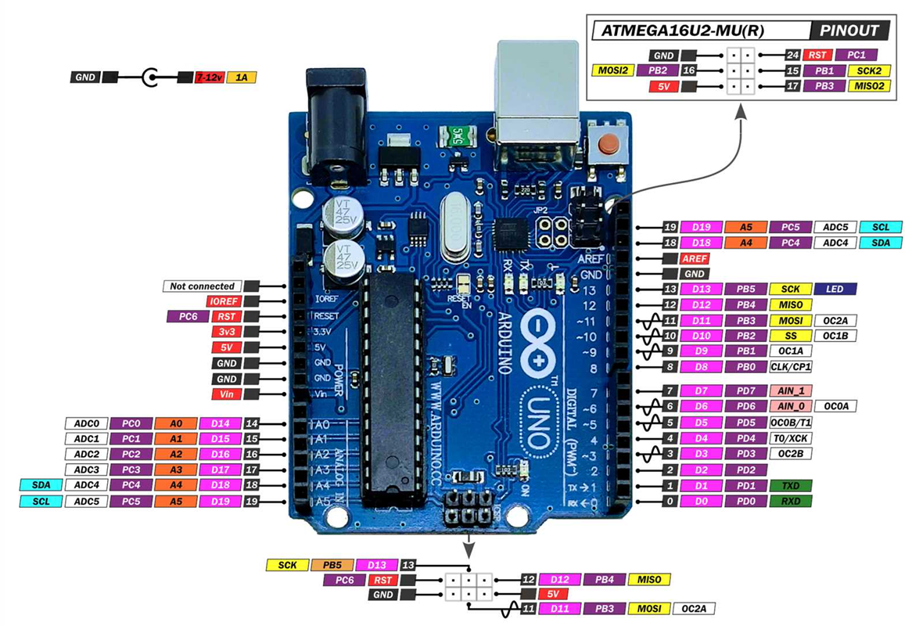

|[:skull:ISSUE](https://github.com/frankyhub/CO2-AnzeigeKI4Kids_SSP/issues?q=is%3Aissue)|[:speech_balloon: Forum /Discussion](https://github.com/frankyhub/CO2-AnzeigeKI4Kids_SSP/discussions)|[:grey_question:WiKi](https://github.com/frankyhub/CO2-AnzeigeKI4Kids_SSP/wiki)||
|--|--|--|--|
| | | | |
<a href="https://github.com/frankyhub/CO2-AnzeigeKI4Kids_SSP/issues">|<a href="https://github.com/frankyhub/CO2-AnzeigeKI4Kids_SSP/discussions">|<a href="https://github.com/frankyhub/CO2-AnzeigeKI4Kids_SSP/6eleases">||
|| <a href="https://github.com/frankyhub/CO2-AnzeigeKI4Kids_SSP/pulse" alt="Activity">| <a href="https://github.com/frankyhub/CO2-AnzeigeKI4Kids_SSP/graphs/traffic">  |<a href="https://github.com/frankyhub?tab=stars"> ||

## Story
Das Repo bescheibt ein Projekt das den CO2-Wert in ppm der Luft und flüchtige organische Verbindungen (Total Volatile Organic Compounds, TVOCs in ppb) in der Umwelt misst und anzeigt. Als Anzeige verwende ich das runde 1,28-Zoll-Display GC9A01, als Sensor einen CCS811 und als Controller dient ein Ardoino UNO.

 
     

## Verdrahtung

|UNO|Display|Sensor|
|--|--|--|
|3,3V|VCC|VCC|
|GND|GND|GND|
|13|SCL|-|
|11|SDA|-|
|7|DC|-|
|10|CS|-|
|8|RST|-|
|SCL|-|SCL|
|SDA|-|SDA|
|--|--|--|

 
   

---

   
<ol class="breadcrumb" style="border-top: 2px solid black;border-bottom:2px solid black; height: 45px; width: 900px;"> 
<a href="#oben">nach oben</a>
</ol>

